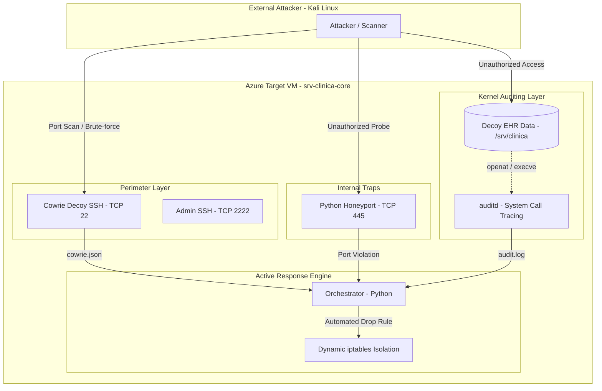

# 🛡️ Cloud Deception & Kernel Telemetry Architecture (Healthcare Scenario)

An active deception, threat-detection, and incident containment architecture designed for a distributed medical infrastructure scenario (*Centro Médico del Sur*).

This project demonstrates a multi-tier defense system combining **perimeter deception (Cowrie Honeypot)**, **internal network traps (SMB Honeyport)**, and **kernel-level telemetry (auditd)** to identify and mitigate intrusions prior to lateral movement or data exfiltration.

---

## 📌 Architecture & Attack Flow



---

## 🛠️ Implementation Status & Roadmap

- [x] **Phase 1: Perimeter Deception (Azure Cloud)**
  - [x] Provision Debian 12 host with strict Network Security Groups (NSGs).
  - [x] Move administrative SSH to port `TCP/2222` (Ed25519 key-based authentication only).
  - [x] Deploy containerized Cowrie SSH/Telnet honeypot listening on standard `TCP/22`.
  - [x] Harden egress filtering (`iptables` anti-relay rules blocking outbound SMTP and RFC 1918 pivoting).
- [x] **Phase 2: Internal Deception & Kernel Telemetry**
  - [x] Deploy lightweight socket-based SMB (`TCP/445`) honeyport listener in Python.
  - [x] Place decoy medical records database (`/srv/clinica/ehr_backup.sql`) with synthetic patient data.
  - [x] Configure Linux kernel audit daemon (`auditd`) rules with dedicated monitoring key.
- [ ] **Phase 3: Active Response & Testing (In Progress)**
  - [ ] Real-time log watcher and JSON parser for Cowrie and auditd alerts.
  - [ ] Automated containment mechanism via dynamic `iptables` drop rules with fail-safe cooldown timers.
  - [ ] Controlled penetration testing from offensive node (Kali Linux).

---

## 📂 Repository Structure

```text
azure-deception-telemetry-lab/
├── README.md               # Project documentation and architectural overview
├── docker/
│   └── docker-compose.yml  # Containerized Cowrie honeypot deployment
├── auditd/
│   └── 99-medical.rules    # Kernel audit rules for decoy files and privilege escalation
├── scripts/
│   ├── honeyport.py        # Python listener for unauthorized port probes
│   └── log_watcher.py      # Telemetry ingestion and automated iptables containment
└── docs/
    └── architecture.md     # In-depth network design, threat model, and SOPs
```

---

## 🚀 Quick Setup & Reproduction

### 1. Perimeter Honeypot Deployment
Ensure Docker and Docker Compose are installed. Relocate the host's administrative SSH port before binding to port 22:
```bash
cd docker/
docker compose up -d
```

### 2. Kernel Telemetry Setup
Load the honeytoken monitoring rules into the Linux Audit subsystem:
```bash
sudo cp auditd/99-medical.rules /etc/audit/rules.d/
sudo augenrules --load
sudo auditctl -l
```

### 3. Internal Honeyport Listener
Execute the decoy listener with elevated permissions:
```bash
sudo python3 scripts/honeyport.py
```

---

## 📄 Academic Context
Developed as part of the *Diplomatura en Ciberseguridad Aplicada* final research project (TFI) / Cybersecurity Research Group (GIC - UTN FRLP). All patient records, credentials, and network logs used are strictly synthetic and isolated.

**Authors:** Lucio Angel & Emiliano Macias
