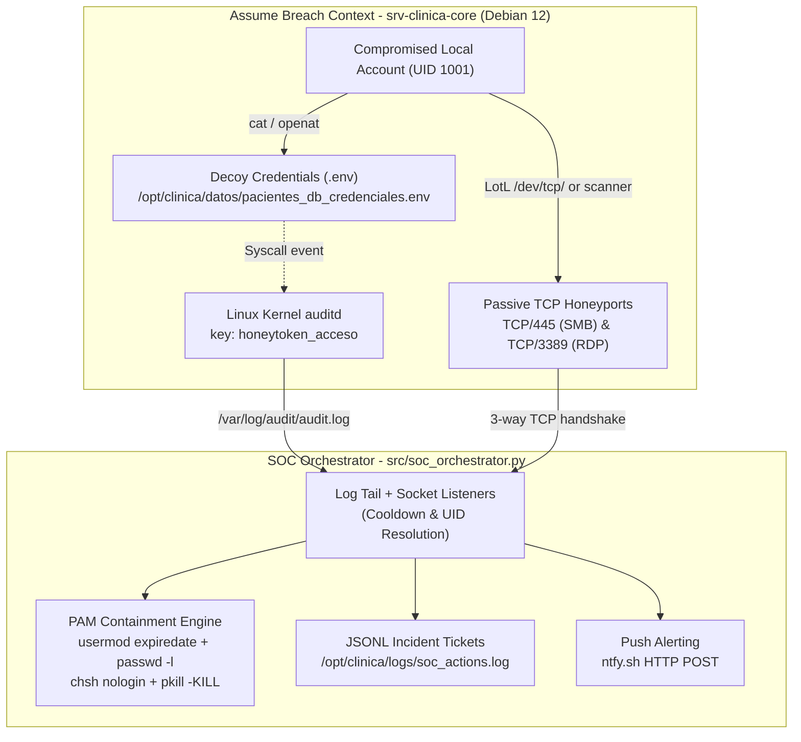

# Cloud Deception, Kernel Telemetry & Automated Response Lab

An **Assume Breach** deception and lightweight SOAR (Security Orchestration, Automation, and Response) proof-of-concept engineered for resource-constrained SMB healthcare environments (*Centro Médico del Sur* reference scenario).

Rather than relying on heavy perimeter honeypots or SIEM stacks, this project combines **Linux kernel telemetry (`auditd`)**, **passive internal TCP honeyports (`445/SMB`, `3389/RDP`)**, **PAM-level identity containment**, **structured JSONL incident ticketing**, and **GRC control traceability (ISO/IEC 27001/27002/27005 & NIST CSF 2.0)** in a zero-dependency Python daemon (~10.6 MB RAM footprint on Debian 12 / Azure `Standard_B1s`).

---

## Architecture & Response Flow



---

## Key Engineering Decisions

- **Assume Breach Pivot (Cowrie Excluded):** Exploratory testing with containerized Cowrie consumed ~200 MB RAM and captured external Internet brute-force noise rather than post-compromise activity. Native Python + `auditd` dropped memory usage to **~10.6 MB** and focused detection on internal reconnaissance and credential access. See [archive/cowrie-exploratory/README.md](archive/cowrie-exploratory/README.md) and [docs/architecture.md](docs/architecture.md).
- **PAM Identity Containment over `iptables`:** Blocking an IP does not terminate an already-authenticated session or safely handle loopback/NAT probes. Furthermore, `passwd -l` alone does **not** block SSH public-key logins—so containment chains `usermod --expiredate 1`, `passwd -l`, `chsh -s /usr/sbin/nologin`, and `pkill -KILL -u`.
- **Living-off-the-Land (LotL) Detection:** Passive TCP sockets detect internal discovery even when tools like `netcat` or `nmap` are absent (validated with Bash native `/dev/tcp/`).
- **GRC Traceability by Design:** Every emitted JSONL ticket maps directly to **ISO/IEC 27001:2022** (`A.8.16`, `A.5.18`, `A.8.20`) and **NIST CSF 2.0** (`DE.CM-01`, `PR.AA-05`, `RS.RP-01`). See [docs/grc-mapping.md](docs/grc-mapping.md).

---

## Repository Structure

```text
azure-deception-telemetry-lab/
├── .github/workflows/
│   └── ci.yml                             # Bytecode, shell syntax, JSONL & unittest CI
├── archive/cowrie-exploratory/
│   ├── README.md                          # ADR-001: why Cowrie was excluded
│   └── docker-compose.yml                 # Exploratory phase Cowrie manifest
├── auditd/
│   └── 99-medical.rules                   # Kernel audit rule (key: honeytoken_acceso)
├── config/
│   ├── pacientes_db_credenciales.env.example  # Sanitized decoy credentials template
│   └── soc-orchestrator.env.example       # Runtime environment configuration template
├── docs/
│   ├── architecture.md                    # Threat model, ADRs & production hardening roadmap
│   ├── grc-mapping.md                     # Asset CIA baseline, risk register & ISO/NIST mapping
│   └── validation-playbook.md             # Reproducible Honeytoken & LotL /dev/tcp/ test steps
├── examples/
│   ├── ntfy_alert.sample.txt              # Sanitized push notification payload format
│   └── soc_actions.sample.jsonl           # Sample forensic JSONL incident tickets
├── scripts/
│   ├── recover_account.sh                 # Post-containment account recovery helper
│   └── setup_lab.sh                       # Debian 12 bootstrap & systemd installation
├── src/
│   ├── __init__.py
│   └── soc_orchestrator.py                # Core daemon (auditd watcher, honeyports, SOAR)
├── systemd/
│   └── soc-orchestrator.service           # systemd service unit definition
└── tests/
    ├── __init__.py
    └── test_soc_orchestrator.py           # Unit & ephemeral socket integration tests
```

---

## Quick Verification & Usage

### 1. Run Automated Tests (No Root Required)

```bash
python3 -m unittest discover -s tests -v
```

### 2. Run in Dry-Run Mode (Local Development)

```bash
python3 -m src.soc_orchestrator --dry-run --no-honeyports \
  --target-user "$USER" \
  --audit-log /tmp/test_audit.log \
  --forensic-log /tmp/test_soc_actions.log
```

### 3. Deploy on Debian 12 Lab VM (`srv-clinica-core`)

```bash
sudo ./scripts/setup_lab.sh
sudo journalctl -u soc-orchestrator.service -f
```

See [docs/validation-playbook.md](docs/validation-playbook.md) for the Honeytoken (`cat`) and LotL (`/dev/tcp/127.0.0.1/3389`) validation steps, and `scripts/recover_account.sh` for safe account restoration.

---

## Academic & Scope Context

Developed as part of the *Diplomatura en Ciberseguridad Aplicada* Final Integrative Project (TFI) at **Universidad Tecnológica Nacional — Facultad Regional La Plata (UTN FRLP)**. All patient records, accounts, credentials, and telemetry examples in this repository are strictly synthetic and isolated for defensive research.

**Authors:** Lucio Angel & Emiliano Macias
